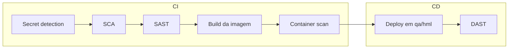

# Segurança no pipeline

1. **Secret detection** é básico, o nome já diz: ele procura segredos vazados. Se um segredo vazou no repositório, removê-lo do código não basta, porque ele continua no histórico do Git. É preciso revogar e trocar o segredo.
2. **SCA** é a validação de segurança por vulnerabilidades (CVE) em pacotes de terceiros.
3. **SAST** são vulnerabilidades no código.
4. **Container scan** são vulnerabilidades na imagem Docker escolhida.
5. **DAST** é o dinâmico: faz alguns testes de vulnerabilidade com cenários de ataque à aplicação já rodando, por isso fica no CD.

## Onde cada uma roda

| Prática | Onde roda |
|---|---|
| Secret detection | CI |
| SCA | CI |
| SAST | CI |
| Container scan | CI, depois do build |
| DAST | CD, em qa/hml |

### Exemplo visual: onde cada uma entra no pipeline



### Exemplos vivos: um comando para cada prática

```bash
gitleaks detect                                      # secret detection: procura segredos no repositório
dotnet list package --vulnerable --include-transitive # SCA: pacotes NuGet com CVE conhecida
trivy image minha-api:abc123                         # container scan: vulnerabilidades da imagem
# SAST: analisador de código (ex.: semgrep) sobre o código-fonte
# DAST: ex.: OWASP ZAP contra a aplicação já rodando em qa/hml
```

Como job de pipeline, bloqueando só severidade alta/crítica (flags do Trivy conferidas de memória):

```yaml
container-scan:
  stage: test
  script:
    - trivy image --severity HIGH,CRITICAL --exit-code 1 $CI_REGISTRY_IMAGE:$CI_COMMIT_SHA
```

## Outros conceitos

- **Shift-left:** colocar a segurança o mais cedo possível no fluxo.
- **Segredos nunca ficam no código nem na imagem.** Entram por variável de ambiente ou cofre (Vault, variáveis protegidas do GitLab/GitHub).
- **Menor privilégio:** a pipeline e a aplicação só recebem as permissões estritamente necessárias.
- **Bloquear ou avisar:** bloquear tudo trava o time, avisar sempre faz ninguém olhar. O comum é bloquear só severidade alta/crítica.
